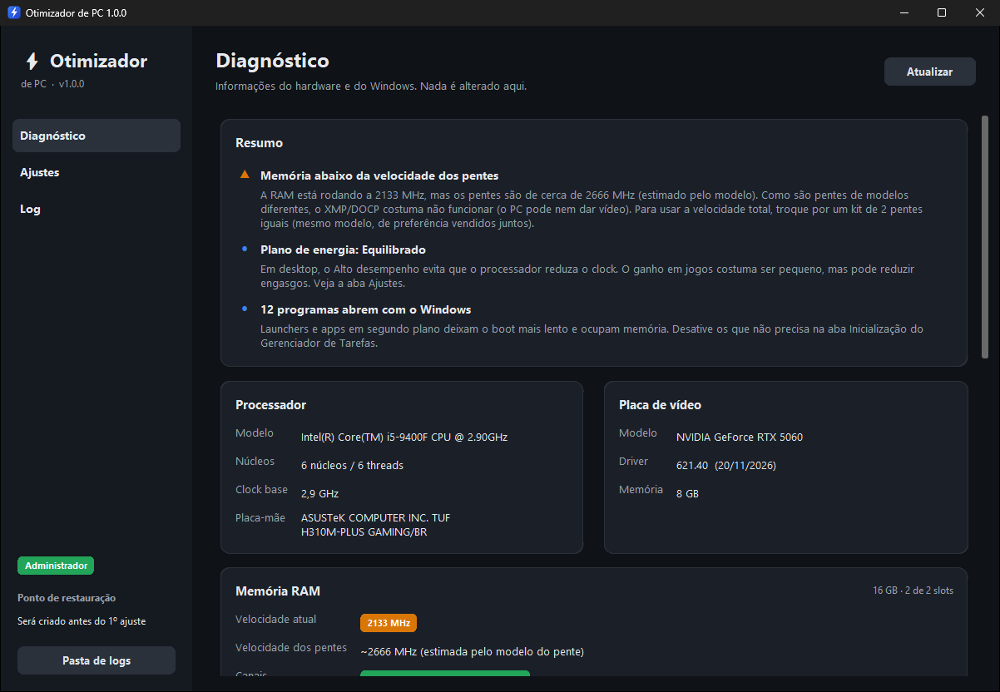
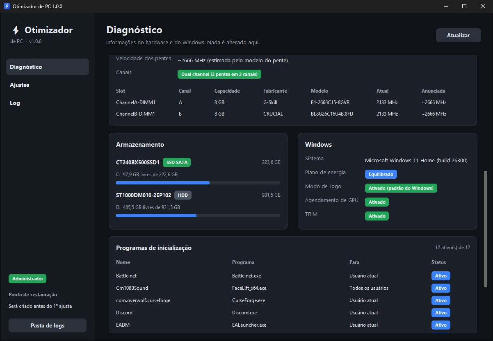
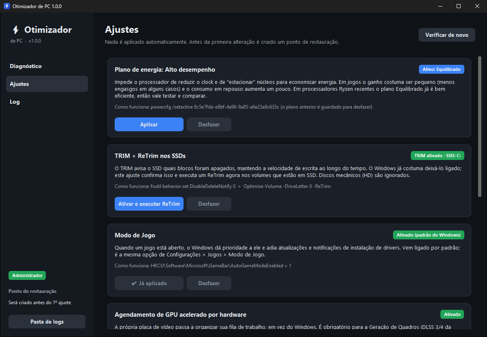
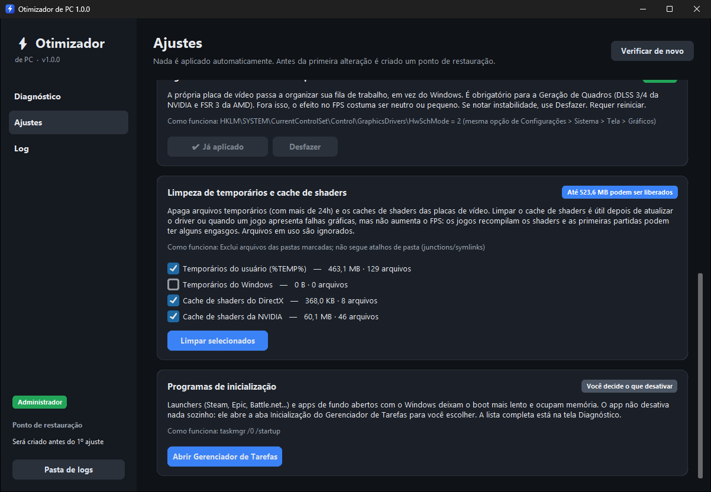
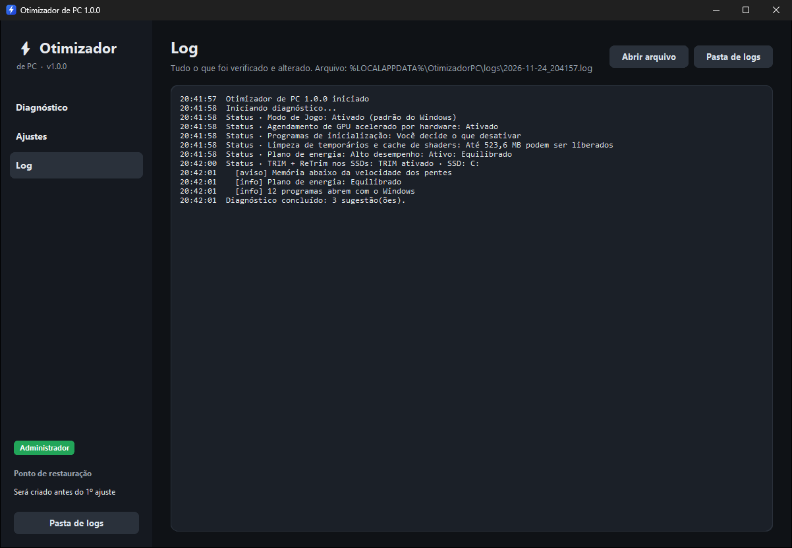

# ⚡ Otimizador de PC

Aplicativo para Windows 10/11, feito em **Python + CustomTkinter**, que faz um **diagnóstico** do PC gamer e oferece **ajustes seguros e reversíveis**. Cada ajuste vem com uma explicação honesta do que faz e do ganho esperado.

Nada é aplicado automaticamente. Antes da primeira alteração o app cria um **ponto de restauração**, todos os ajustes de configuração têm botão **Desfazer** e tudo fica registrado em **log**.



## Funcionalidades

### Diagnóstico (somente leitura)
| Item | Detalhes |
|---|---|
| Processador | Modelo, núcleos/threads, clock base e placa-mãe |
| Placa de vídeo | Modelo, versão e data do driver (formato NVIDIA, como `621.40`, quando aplicável) e VRAM |
| Memória RAM | Total, slots usados, **velocidade atual x velocidade dos pentes** (detecta XMP/DOCP desligado), **dual channel** e pentes de modelos diferentes |
| Armazenamento | Tipo de cada disco (**SSD NVMe / SSD SATA / HDD**) e espaço livre por unidade |
| Windows | TRIM, plano de energia, Modo de Jogo e agendamento de GPU acelerado por hardware |
| Inicialização | Programas que abrem com o Windows e se estão ativos ou desativados |
| Resumo | Sugestões priorizadas a partir do que foi encontrado |



### Ajustes (um botão para cada, sempre com confirmação)
| Ajuste | O que faz | Desfazer |
|---|---|---|
| Plano **Alto desempenho** | `powercfg /setactive` (recria o plano se ele estiver oculto) | Volta ao plano anterior |
| **TRIM + ReTrim** | Garante o TRIM ligado e roda `Optimize-Volume -ReTrim` **apenas nos SSDs** | Restaura a configuração anterior |
| **Modo de Jogo** | Mesma opção de Configurações > Jogos | Restaura o valor anterior |
| **Agendamento de GPU** | Mesma opção de Configurações > Tela > Gráficos (requer reiniciar) | Restaura o valor anterior |
| **Limpeza** | Temporários (com mais de 24h) e caches de shaders DirectX/NVIDIA/AMD/Intel, **mostrando quanto espaço será liberado** | — (arquivos descartáveis) |
| **Inicialização** | Abre a aba Inicialização do Gerenciador de Tarefas | — (você decide) |




### Segurança
- **Pede administrador ao abrir** (UAC). Se você recusar, o app abre só o diagnóstico, em modo somente leitura.
- **Ponto de restauração** antes da primeira alteração da sessão. Se a Proteção do Sistema estiver desligada, o app pergunta se você quer ativá-la. O Windows só permite um ponto a cada 24h; nesse caso o app avisa e usa o ponto existente.
- **Log** de cada verificação, comando e resultado em `%LOCALAPPDATA%\OtimizadorPC\logs`.



## O que o app **não** faz (de propósito)

"Otimizadores" da internet costumam desativar serviços do Windows, mexer em parâmetros de rede e TCP no registro, "debloatar" o sistema ou mudar prioridades de processos. Muitas dessas mudanças **não têm ganho mensurável**, algumas pioram a estabilidade ou a segurança e quase nenhuma é fácil de reverter.

Este projeto segue uma regra simples: **só entram ajustes documentados, seguros e reversíveis**, com uma explicação honesta do ganho esperado. Por exemplo, o app avisa que o plano Alto desempenho costuma render pouco em jogos e que limpar o cache de shaders não aumenta o FPS.

A melhoria mais importante que o diagnóstico costuma encontrar nem é um "ajuste do Windows": é a **RAM rodando abaixo da velocidade de fábrica** porque o XMP/DOCP está desligado na BIOS.

## Como rodar

Requisitos: Windows 10/11 e Python 3.10 ou mais recente.

```powershell
git clone https://github.com/<seu-usuario>/otimizador-pc.git
cd otimizador-pc
python -m venv .venv
.\.venv\Scripts\Activate.ps1
pip install -r requirements.txt
python -m otimizador          # pede administrador (UAC)
python -m otimizador --sem-admin   # só diagnóstico, sem UAC
```

## Gerar o executável

```powershell
.\build.ps1
```

O script cria o ambiente virtual se for preciso, roda os testes e gera `dist\OtimizadorPC.exe` com PyInstaller (arquivo único, sem console, já pedindo administrador ao abrir).

> **Aviso:** executáveis do PyInstaller sem assinatura digital às vezes são marcados pelo SmartScreen ou por antivírus (falso positivo). O código-fonte completo está aqui para conferência.

## Testes

```powershell
pip install -r requirements-dev.txt
python -m pytest
```

Os testes usam **saídas reais** do PowerShell, sem dados pessoais, e cobrem a interpretação do hardware (canais de memória de placas ASUS, MSI e AM4, velocidade pelo part number, tipos de disco), dos planos de energia em português e inglês, do status de inicialização e das recomendações. A limpeza é testada em pastas temporárias, incluindo a garantia de que **atalhos de pasta (junctions) nunca são seguidos**.

## Estrutura do projeto

```
otimizador/
├── principal.py          # entrada: UAC, log e janela
├── core/                 # infraestrutura
│   ├── admin.py          # verifica e solicita administrador
│   ├── shell.py          # PowerShell/executáveis sem abrir janelas, saída em UTF-8
│   ├── restauracao.py    # ponto de restauração (com a regra das 24h)
│   ├── estado.py         # valor original de cada ajuste, para o Desfazer
│   ├── d3dkmt.py         # consulta direta ao driver de vídeo (HAGS)
│   ├── registro.py, formato.py, log.py
├── diagnostico/          # somente leitura
│   ├── coleta.py         # busca os dados brutos (1 processo PowerShell + registro)
│   ├── hardware.py       # interpreta CPU, GPU, RAM e discos (funções puras)
│   ├── sistema.py        # interpreta energia, TRIM, Modo de Jogo, HAGS e inicialização
│   └── __init__.py       # monta o diagnóstico e as recomendações
├── ajustes/              # cada ajuste: status(), aplicar(), desfazer()
│   ├── base.py
│   ├── energia.py, trim.py, modo_jogo.py, agendamento_gpu.py, limpeza.py, inicializacao.py
└── ui/                   # CustomTkinter: não conhece nenhum comando do Windows
    ├── app.py            # janela, navegação e fluxo do ponto de restauração
    ├── tela_diagnostico.py, tela_ajustes.py, tela_log.py
    ├── componentes.py, tema.py
    └── tarefas.py        # executa em segundo plano sem travar a janela
tests/                    # pytest
tools/                    # gerar ícone, capturar prints, metadados do .exe
build.ps1                 # gera o .exe
```

## Decisões técnicas

- **Independente de hardware:** nada é fixo para Intel, AMD ou NVIDIA. Os planos de energia são identificados pelo GUID (não pelo nome, que muda com o idioma). Os SSDs NVMe são reconhecidos mesmo quando o Windows informa `MediaType = Unspecified`. Os nomes de slot de memória são interpretados para vários fabricantes de placa-mãe.
- **Estado real do agendamento de GPU:** o registro (`HwSchMode`) só guarda a preferência e muitas vezes nem existe. O app pergunta direto ao driver pela API `D3DKMTQueryAdapterInfo` (via `ctypes`) se a placa suporta o recurso e se ele está ativo.
- **Rápido e sem janelas piscando:** toda a consulta WMI roda em **um único** processo do PowerShell (`-EncodedCommand`, saída em JSON), em paralelo com as outras leituras, e cada processo é criado com `CREATE_NO_WINDOW`.
- **Interface responsiva:** o trabalho pesado roda em threads, e os resultados voltam para a thread do Tkinter por uma fila, porque o Tkinter não é thread-safe.
- **Desfazer correto:** o valor original é gravado só na **primeira** aplicação. Aplicar duas vezes não faz o "Desfazer" voltar para um estado já modificado.
- **Privacidade:** a lista de inicialização mostra só o nome do executável, nunca o caminho completo (que pode conter o nome do usuário).

## Licença

[MIT](LICENSE)
